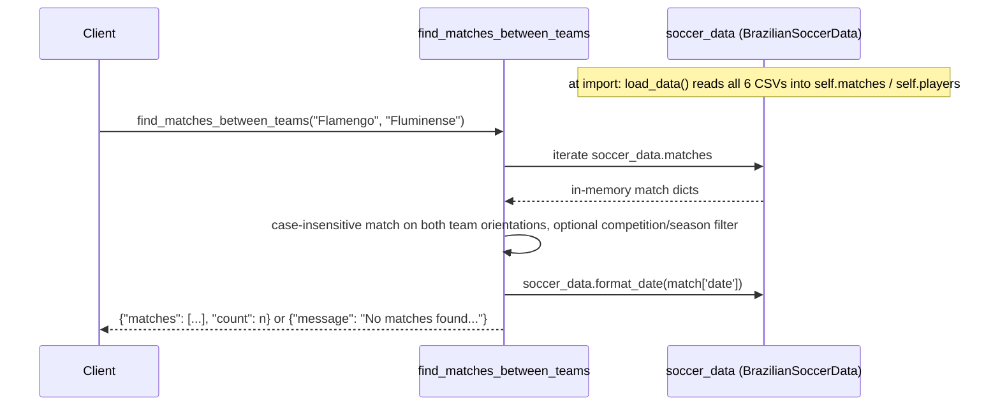

# Flow

A tool call scans the pre-loaded `soccer_data.matches` list linearly (no index), matching team names case-insensitively in both home/away orientations, applies optional competition/season filters, formats each hit, and returns a dict. All data is loaded eagerly into memory once at module import via the `soccer_data = BrazilianSoccerData()` singleton.

Deviations from common patterns:
- No input validation on team/competition/season arguments.
- Linear O(n) scan of the full match list per query; no indexing or pagination.
- Goals and season are stored as strings and parsed ad hoc with `.isdigit()`; `get_head_to_head` calls `int()` directly and could raise on non-numeric scores.
- `get_competition_standings` (R9) is a stub returning a placeholder message — no points/positions are computed.
- MCP registration is wrapped in a bare `try/except` that logs success even when the decorator fails; a `MockServer` fallback lets the module import without the MCP SDK installed.
- Tests are assertion-light: they mostly check that functions execute and print checkmarks rather than verifying returned values.
