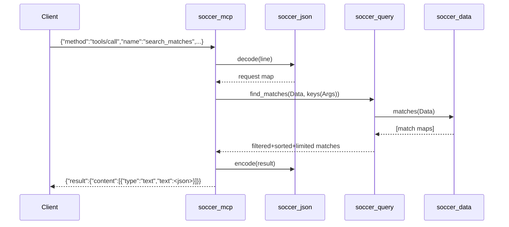

# Flow

At start-up `soccer_mcp:main/0` calls `soccer_data:load/0`, which reads all six CSVs once into an in-memory `#{matches => [...], players => [...]}` map, then enters a blocking `io:get_line/1` loop. Each line is decoded as a JSON-RPC request; `tools/call` maps the camelCase argument keys to internal atoms (`keys/1`) and dispatches to the matching `soccer_query` function. Results are re-encoded as a JSON string inside an MCP `content` text block. Errors are caught per-request and returned as JSON-RPC error objects (`-32601` unknown method, `-32602` handler exception, `-32700` parse error), so a bad request does not crash the loop.

Deviations from common patterns worth noting: the server entry point lives in module `soccer_mcp`, not a module named after the application (`brazilian_soccer_mcp`), so the harness runtime/factual probe — which looks for a zero-arity `main/run` in `brazilian_soccer_mcp` — found no entry and could not profile the server. Arguments are passed straight to query functions with no schema validation (all tool `inputSchema` are empty objects). Data loading is synchronous and eager at boot.
