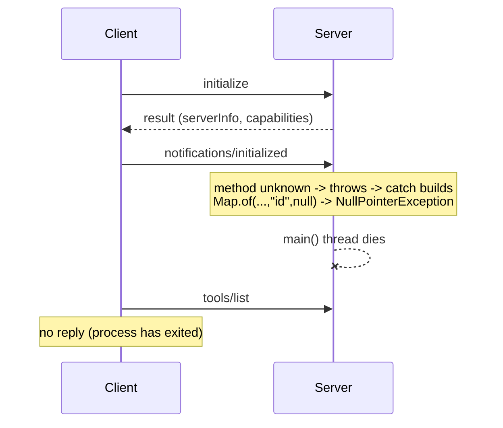

# Flow

The MCP lifecycle is `initialize` → `notifications/initialized` → normal traffic. This server answers `initialize` correctly, but the required `notifications/initialized` notification has an unrecognized method, so `response()` hits its `default ->` branch and throws. The `catch` in `main()` tries to emit a JSON-RPC error whose envelope is `Map.of("jsonrpc","2.0","error",...,"id",null)` — but `Map.of` rejects null values, so it throws a `NullPointerException` that is not caught. The `main` thread dies and the server exits before `tools/list` is ever read. The same crash is triggered by any unknown method, any unknown tool name, and any missing required argument (`team_statistics`/`head_to_head` throw on missing args). The unit tests never go through this transport — they call `SoccerService` directly — so the crash is invisible to the test suite.
