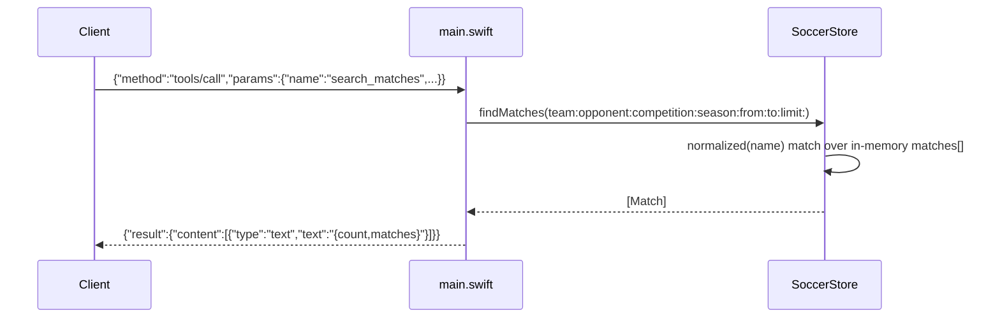

# Flow

On startup `SoccerStore.init` eagerly parses all six CSVs into `matches[]`/`players[]` once; every query is an in-memory `filter`/`reduce`. A `tools/call` request is dispatched by name in `handle`, which calls the matching store method and wraps the JSON payload as MCP text content.

Notable deviations:
- **Hand-rolled MCP** — no server SDK; the JSON-RPC loop and tool schemas are implemented directly.
- **Name matching is substring-based** after accent/suffix folding (`a.contains(q) || q.contains(a)`), which can over-match short names.
- **No deduplication across source files** — the five match CSVs overlap (e.g. Brasileirão appears in both `Brasileirao_Matches.csv` and `novo_campeonato_brasileiro.csv`), and `standings` aggregates whatever rows exist; a club whose name is spelled differently across files (Athletico vs Atletico Paranaense) is split into two table rows.
- No pagination beyond a `limit` cap (500); no error handling for malformed CSV rows (they are silently dropped).
