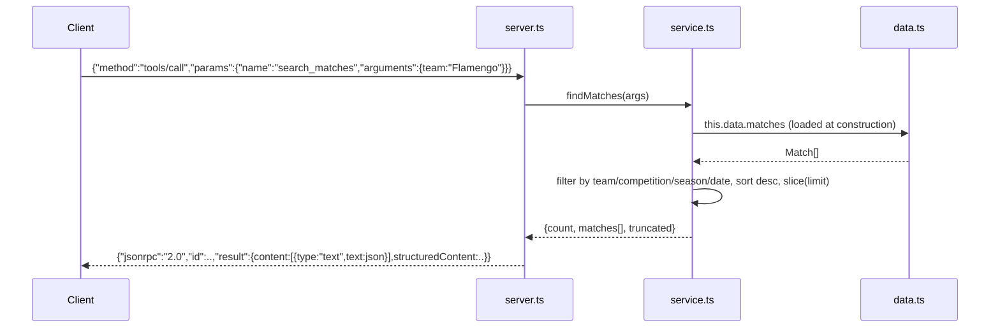

# Flow

On startup `SoccerData` eagerly reads and parses all six CSVs into `matches`/`players` arrays (synchronous `readFileSync`). Each `tools/call` runs an in-memory linear scan: `findMatches` is the shared primitive that `teamStats`, `headToHead`, and `aggregate` all build on. Notable deviations from common patterns: no official MCP SDK (JSON-RPC is hand-written on a readline loop); tool `inputSchema`s are untyped (`additionalProperties:true`); no input validation beyond required-arg checks; the five match sources are concatenated without de-duplication, so the same real match appears under multiple `source`/`competition` labels (e.g. 2019 Brasileirão is present in both the `brasileirao` and `historical` sources and again as `Serie A` in the extended set).
