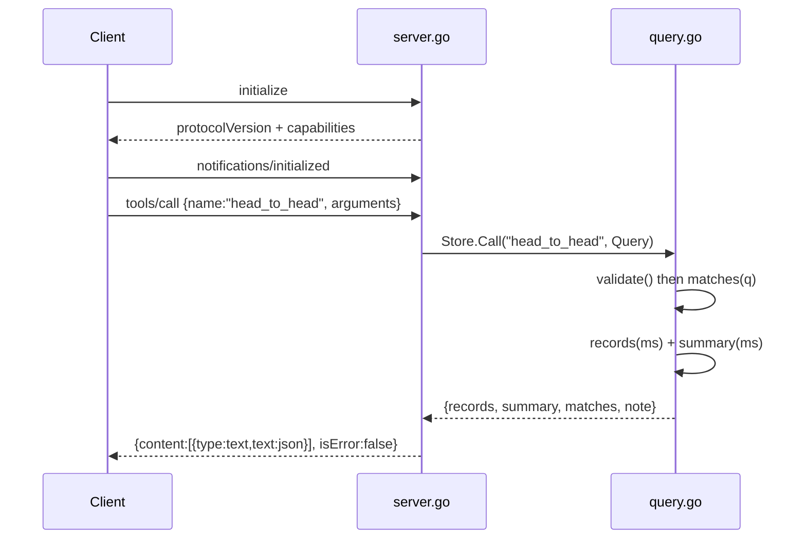

# Flow

A client performs the MCP handshake (`initialize` → `notifications/initialized`),
which gates `tools/list` and `tools/call` behind a `ready` flag (unready calls
return JSON-RPC error -32002). On `tools/call`, `server.go` strictly decodes the
arguments into a `Query` (unknown fields rejected), dispatches to
`Store.Call`, which validates the query then filters the in-memory match slice,
aggregates records/summaries, paginates, and returns a JSON text block. All data
is loaded once at startup from CSV; queries are pure reads over slices.

Notable: strict JSON decoding (`DisallowUnknownFields`) on both tool-call params
and arguments; tool-call errors are surfaced as `isError:true` result content
rather than protocol errors; no network or external API access; team names
normalized (accents, state suffixes, aliases) before matching.
