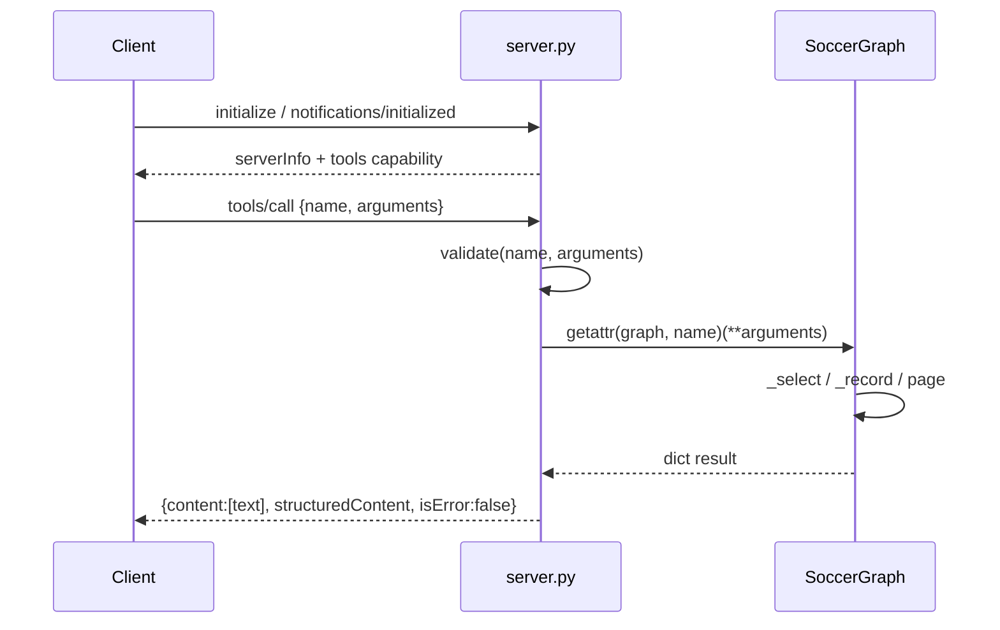

# Flow

A client completes the MCP handshake (`initialize` then `notifications/initialized`); until then every request except `ping`/`initialize` is refused with `-32002`. On `tools/call`, the server validates arguments against the reflected JSON schema (type/enum/range/required checks), dispatches by name to the matching `SoccerGraph` method, and returns the result both as pretty-printed JSON text and as `structuredContent`. `ValueError`/`TypeError` from the graph become tool-level `isError:true` results rather than protocol errors. `SoccerGraph` is built once at startup, reading all six CSVs into memory and deduplicating fixtures across sources.

Notable: strict argument validation with `additionalProperties:false`; cross-source fixture dedup with one-day date tolerance; all data in-memory (no DB); no network calls; read-only tool annotations. UTF-8 reconfigured on stdin/stdout for Portuguese text.
