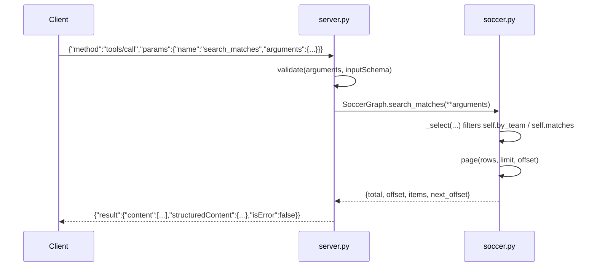

# Flow

On construction, `SoccerGraph.__init__` reads all six CSVs once, normalizes team names,
converts rows to a common match shape, and **deduplicates the same fixture across sources**
(merging by competition/date/teams, or by matching scores within one day), building
`self.matches`, `self.players`, and a `by_team` index. A `tools/call` request is parsed from a
stdin line, validated against the tool's generated JSON-Schema, dispatched to the matching
`SoccerGraph` method, and returned as both `content` text and `structuredContent`. Errors raised
by the engine (`ValueError`/`TypeError`/`KeyError`) are returned as `isError: true` results rather
than JSON-RPC errors. Input validation, UTF-8 handling, multi-format date parsing, pagination, and
provenance tracking are all present; there is no network access or external dependency.
