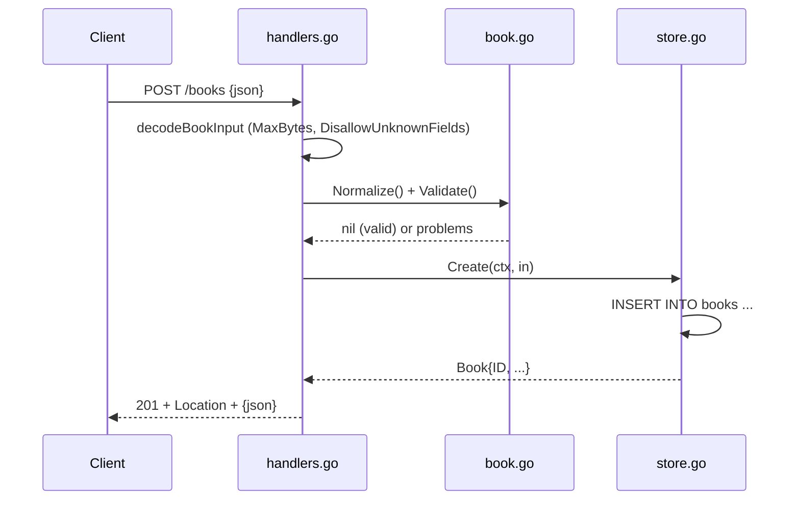

# Flow

A `POST /books` request body is size-capped (1 MiB) and strictly decoded (unknown/trailing fields rejected with 400), then normalized and validated — title and author are required, year and ISBN are checked when present. On success the store inserts the row and returns the book with its assigned ID; the handler replies 201 with a `Location` header. Errors are returned as JSON (`{"error": ..., "details": {...}}`). Notable: strict JSON decoding, context propagated to all DB calls, graceful server shutdown, and ISBN-10/13 checksum validation beyond the spec.
