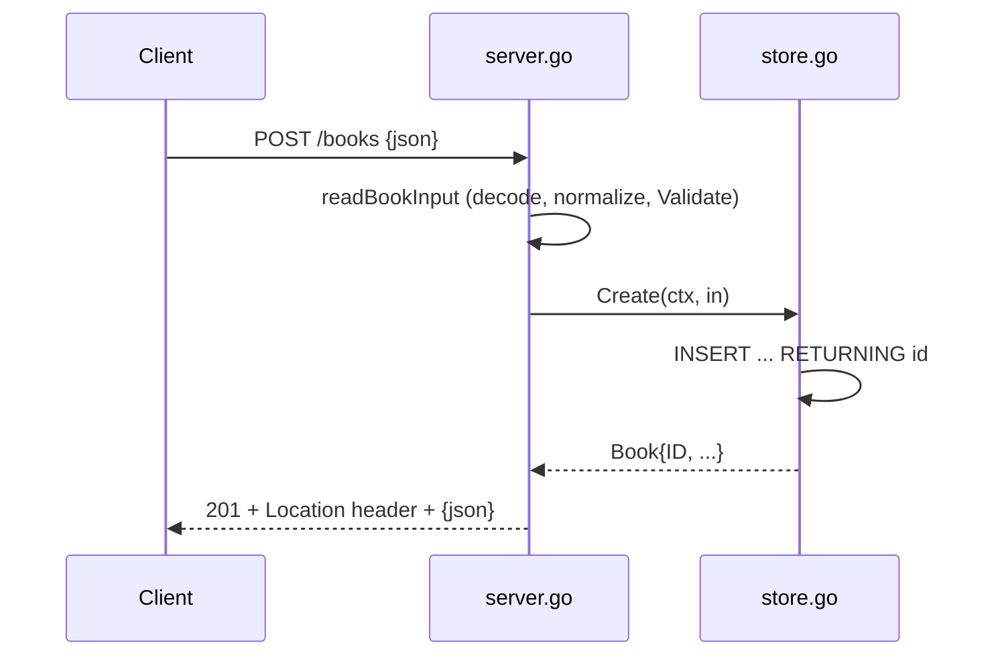

# Flow

A `POST /books` request is decoded with `DisallowUnknownFields` under a 1 MiB
`MaxBytesReader`, trimmed via `normalize()`, then validated (title/author required,
year range, ISBN check digit). Valid input is inserted with SQLite's `RETURNING id`,
and the created book is returned as JSON (201) with a `Location` header. Invalid input
returns 400 with per-field problems; routing misses are rewritten to JSON errors.
Input validation, bounded body size, unknown-field rejection, and graceful shutdown
are all present.
