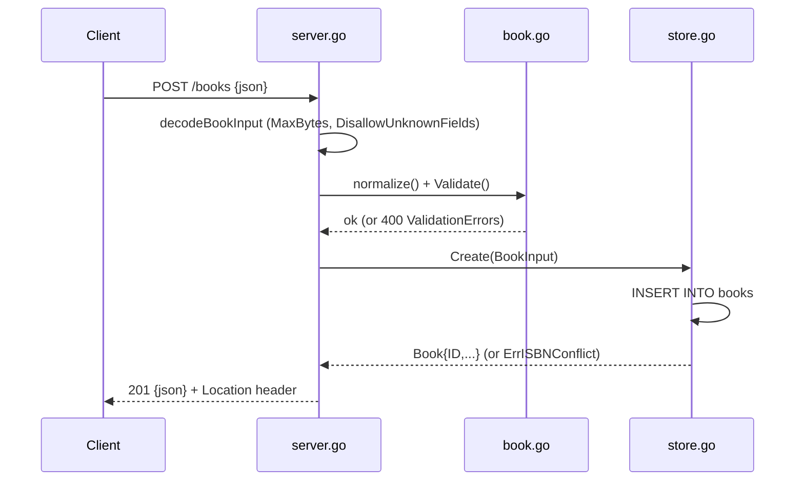

# Flow

A `POST /books` request is size-capped and JSON-decoded with unknown-field and
trailing-content rejection, normalized (trim, canonicalize ISBN) and validated
(title/author required, optional year range and ISBN format). On success the
handler inserts via `store.go:Create`, which maps a unique-ISBN violation to
`ErrISBNConflict` (409). The created book is returned as `201` JSON with a
`Location` header. Error mapping is centralized in `writeStoreError`
(404/409/500) and `writeValidationError` (400).
