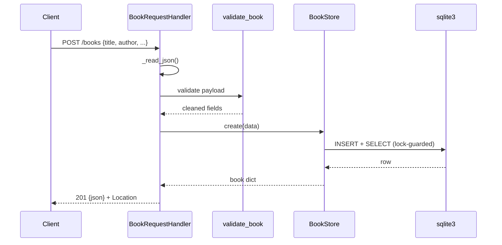

# Flow

A request is routed by `_dispatch`, which normalises the path (trailing slash stripped) and matches `/health`, `/books`, or `/books/{id}` via a compiled regex. `POST /books` reads a length-bounded JSON body, validates it through `validate_book` (title/author required, year/isbn range-checked and normalised), then persists via a `BookStore` sharing one `sqlite3` connection guarded by a `threading.Lock`. Responses are JSON with explicit status codes (201/200/204/400/404/405). Notable: a single shared connection serialises all DB access behind the lock; `?author=` filters case-insensitively (`COLLATE NOCASE`); PUT applies partial updates (any subset of fields, omitted fields preserved).
