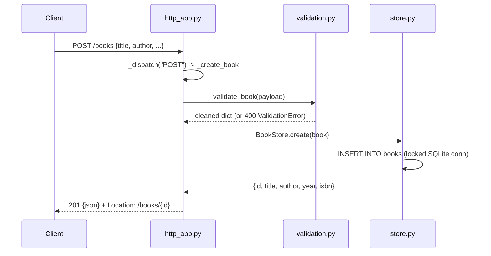

# Flow

A request is routed by `_dispatch`, which matches the path against the `ROUTES` regex table and selects a handler by HTTP method (JSON 405 with `Allow` for a known path + wrong method, JSON 404 otherwise). `_create_book` reads and JSON-parses the body (enforcing `Content-Length` and a 1 MiB cap), validates it via `validate_book` (title/author required, optional year range and ISBN-10/13 checksum), and persists via `BookStore`, which guards a single shared SQLite connection with a `threading.Lock`. All responses are JSON with explicit status codes. Threaded server (`ThreadingHTTPServer`) with daemon threads; no auth, no pagination (full list, optional exact case-insensitive author filter).
