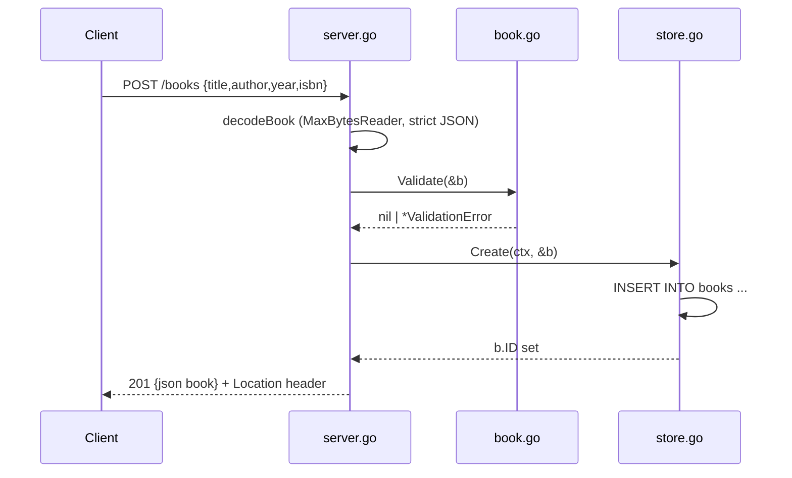

# Flow

A `POST /books` request is size-capped via `MaxBytesReader`, decoded strictly (unknown fields ignored, trailing JSON rejected), then validated by `book.Validate` which trims text, normalizes the ISBN, and requires title and author. On validation failure a `400` with a per-field `details` map is returned. Otherwise `store.Create` inserts the row (single-writer SQLite connection, WAL mode) and the generated id is set on the book, which is echoed back as `201` with a `Location` header. Error handling is thorough: validation errors, malformed/oversized bodies, not-found, method-not-allowed, and unknown routes all return JSON. Store access is synchronous and context-aware.
