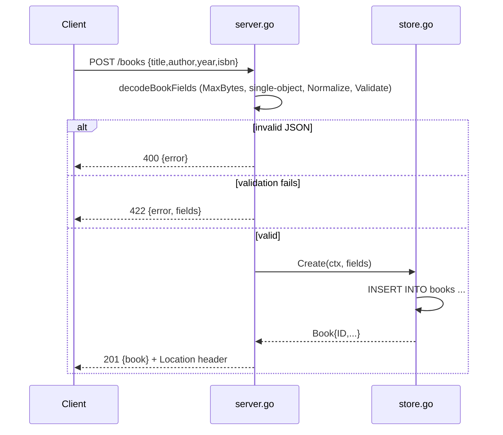

# Flow

A `POST /books` request is capped at 1 MiB, decoded as a single JSON object (trailing data rejected), then whitespace-trimmed and validated: `title` and `author` are required; `year` (if non-zero) must fall between 1 and next year; `isbn` (if present) must pass an ISBN-10/13 check-digit test. Valid books are inserted into SQLite via `modernc.org/sqlite` (pure-Go, cgo-free), and the created book is returned with a `Location` header. Validation failures return 422 with a per-field map; malformed bodies return 400. The store uses a single connection (`SetMaxOpenConns(1)`) and `context`-aware queries throughout.
