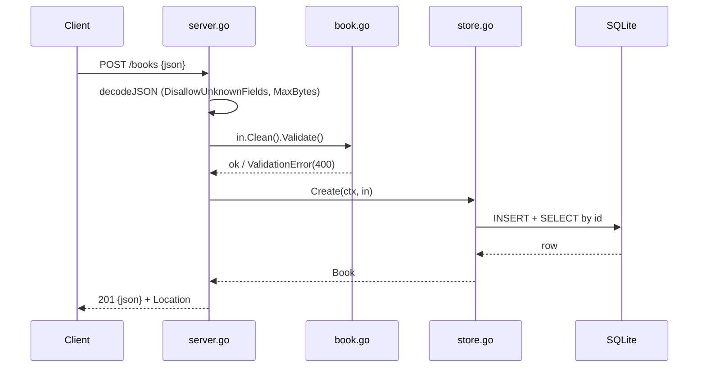

# Flow

A `POST /books` request has its body decoded with unknown-field rejection and a 1 MiB cap, then the input is trimmed and validated (title/author required, year range, ISBN check-digit). On success `Store.Create` inserts the row and re-reads it to return the server-assigned id, and the handler responds `201` with a `Location` header. Deviations from the minimal pattern: ISBN-10/13 checksum validation, case-insensitive author filtering via `COLLATE NOCASE`, single-connection pool to avoid SQLite write locks, and graceful shutdown on SIGINT/SIGTERM in `main.go`.
