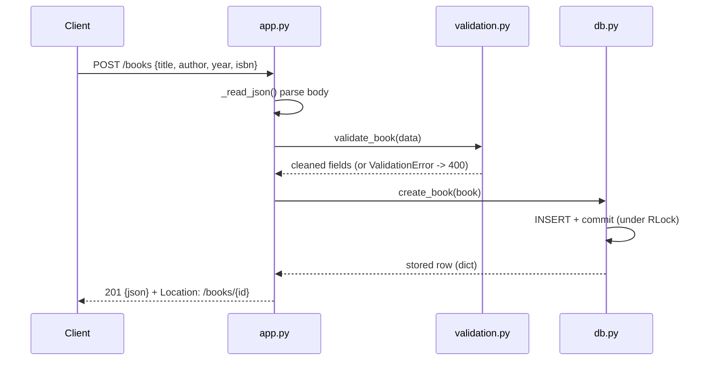

# Flow

A `POST /books` request is read and JSON-decoded in `_read_json`, then passed through `validation.validate_book`, which requires `title` and `author`, normalizes text and ISBN, and collects all field errors into a single 400 response. On success the cleaned record is inserted via `db.Database.create_book`, which holds an `RLock` around a single shared SQLite connection and returns the persisted row (with its new id), serialized as JSON with a `Location` header. Errors are centralized: `ValidationError` → 400 with per-field details, `ApiError` → its status, any other exception → logged 500. Persistence is real SQLite (file-backed when `--db` is given), verified by a restart test.
