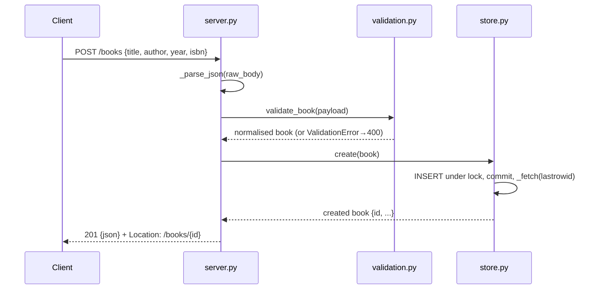

# Flow

A `POST /books` is read by `BookRequestHandler._dispatch`, which enforces the Content-Length limits, then calls `handle_request` → `_route` → `_create_book`. The body is JSON-parsed and passed to `validate_book`, which normalises `title`/`author` (required, trimmed, length-capped), `year` (optional int in range) and `isbn` (optional, format-checked, compacted), reporting every problem at once as a 400. The validated dict is inserted via a single lock-guarded shared SQLite connection and the stored row (with its new `id`) is returned as 201 with a `Location` header.

Notable, factual deviations from the plainest approach: routing is a pure `handle_request(store, method, target, body)` function decoupled from sockets, so it is testable without binding a port; the server is threaded with a single shared connection guarded by a `threading.Lock`; oversized bodies are rejected without being read (413 + connection close); ISBN check digits are not verified (format only); duplicate ISBNs are allowed.
