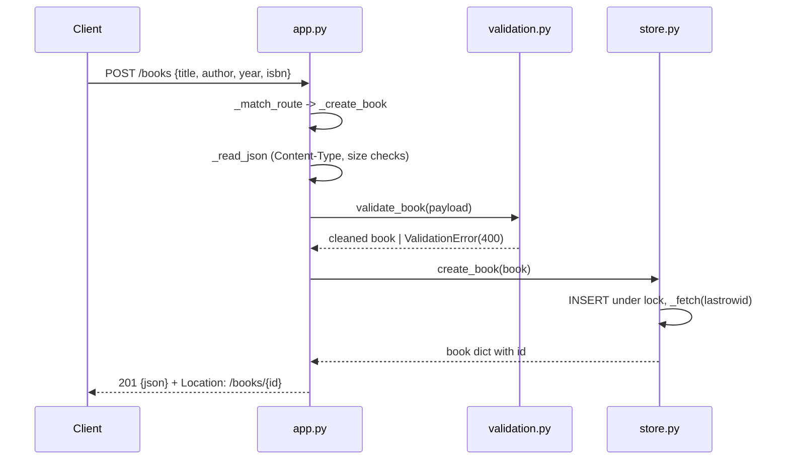

# Flow

A `POST /books` request is routed by regex `fullmatch` in `_match_route`, then `_create_book` calls `_read_json` (which enforces `application/json`, a positive `Content-Length`, and a 1 MB body cap), passes the parsed body through `validate_book` (required trimmed `title`/`author`, optional bounded `year`, optional checksum-verified ISBN; unknown keys like client-supplied `id` are dropped), and persists via `BookStore.create_book` under a `threading.Lock` on a single shared SQLite connection. The handler returns `201` with a `Location` header. Errors are mapped centrally in `BookApp.__call__`: `HttpError` -> its status, `ValidationError` -> `400` with per-field `details`, any other exception -> logged `500`. Notable: robust edge handling (trailing-slash normalization, `405` with `Allow` header, SQLite id overflow mapped to `404` not `500`), SQLite persistence verified across reopen, and a real-socket end-to-end CRUD test.
