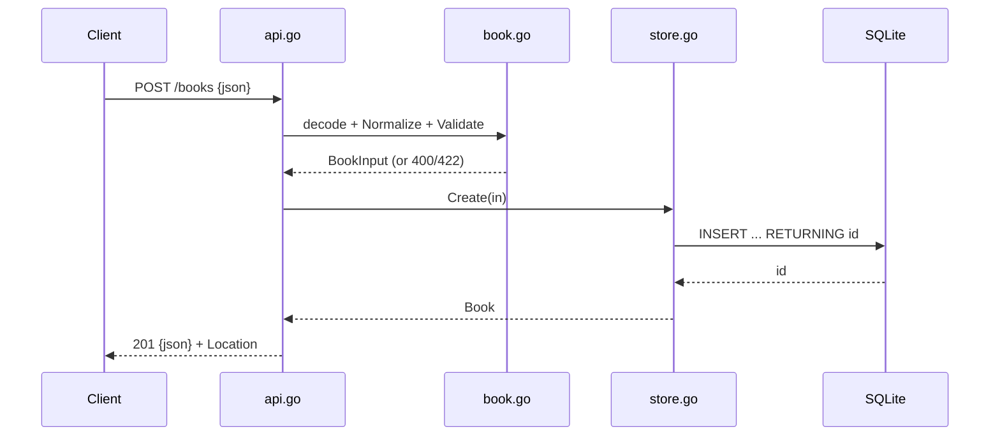

# Flow

A `POST /books` request is read with a 1 MiB body cap, JSON-decoded into
`BookInput`, trimmed by `Normalize`, then `Validate` enforces required
title/author, non-negative year, and ISBN-10/13 shape — returning 400 on
malformed JSON and 422 on validation failure. On success the handler calls
`Store.Create`, which inserts into the SQLite `books` table and returns the
row with its assigned id, serialized as 201 JSON with a `Location` header.
The author filter is pushed into SQL (`WHERE author = ? COLLATE NOCASE`).
