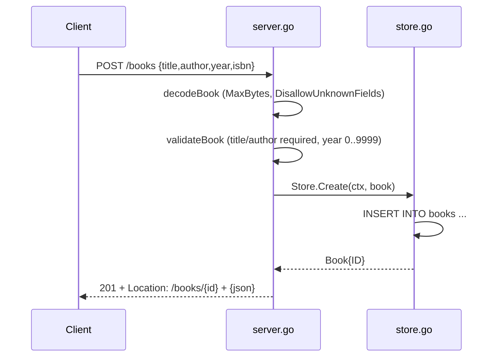

# Flow

A `POST /books` request is size-limited to 1 MiB and decoded with
`DisallowUnknownFields` plus a trailing-data check; the body is trimmed and
validated (title and author required, year bounded 0–9999) before an INSERT.
On success the handler sets a `Location` header and returns 201 with the created
book. Errors are returned as `{"error": msg}` JSON: 400 for bad input, 404 for
missing IDs, 500 for internal/DB errors (logged, not leaked), 503 for `/health`
when the DB is unreachable. All persistence is context-aware SQLite; no
in-memory shortcut.
