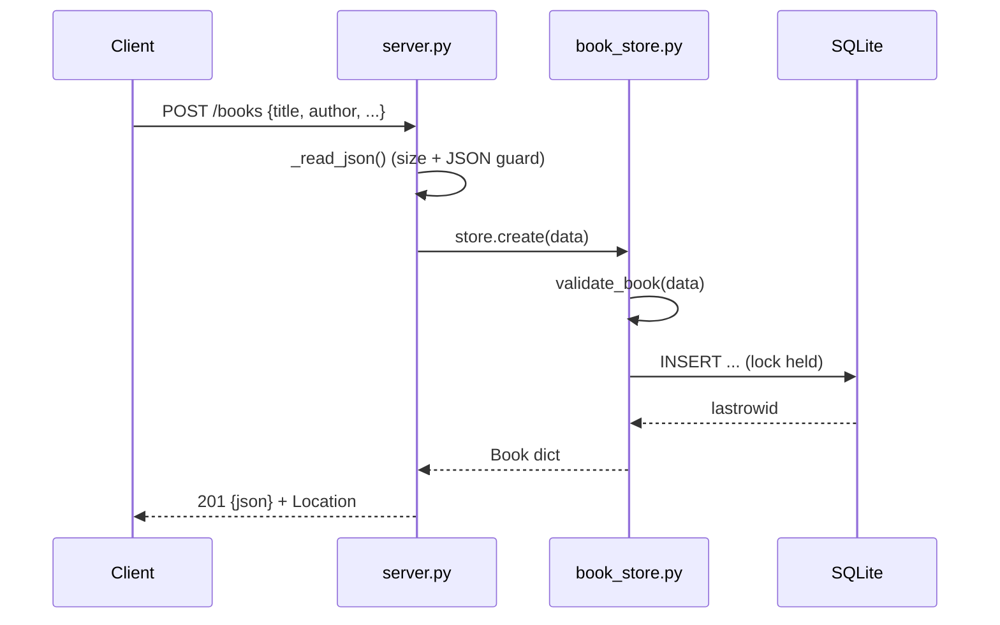

# Flow

A `POST /books` reads and size-limits the body, parses it as JSON, then hands it
to `BookStore.create`, which validates (title/author required, year 1–9999, bool
year rejected) before inserting into SQLite under a threading lock. The new row is
re-fetched and returned as JSON with `201` and a `Location` header. All store
operations serialise on a single shared connection guarded by one lock, so the
threaded server never races on the one SQLite connection.
