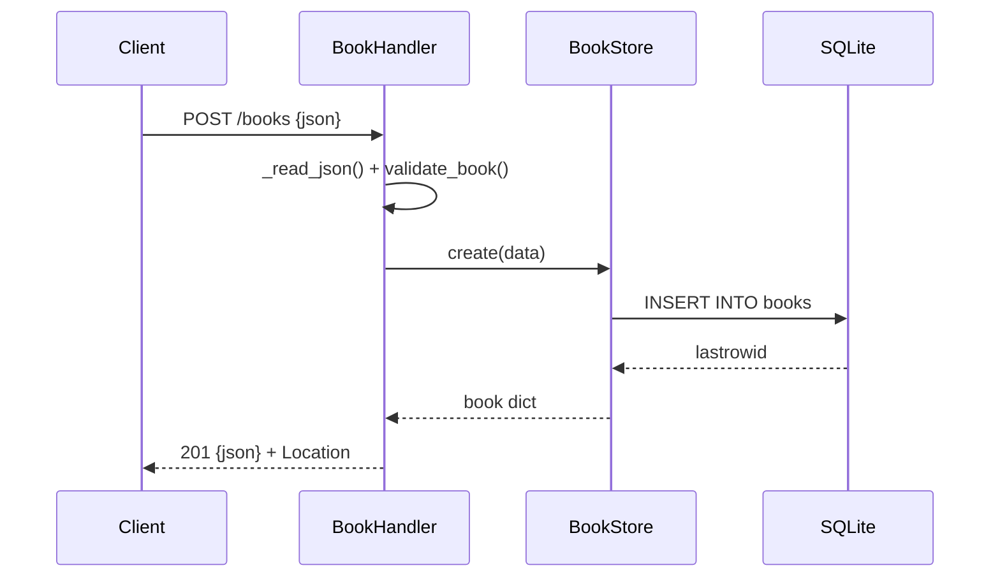

# Flow

A `POST /books` is dispatched through `_dispatch`, which wraps the handler in a
try/except that maps `ValidationError` to 400 and `ConflictError` to 409. The body
is read with a `Content-Length` bound (`MAX_BODY_BYTES`), parsed as JSON, and passed
to `validate_book`, which trims/validates `title` and `author` (required) and bounds
`year` to 0–9999. `BookStore` shares one `sqlite3` connection across request threads
guarded by a lock; the INSERT is committed and the stored row is re-read and returned
as JSON with a `Location` header. Uniqueness conflicts on `isbn` surface as a 409.
Notable: synchronous SQLite behind a thread lock (correct but serialised); full-replace
PUT semantics (omitted `year`/`isbn` are cleared, documented in README).
