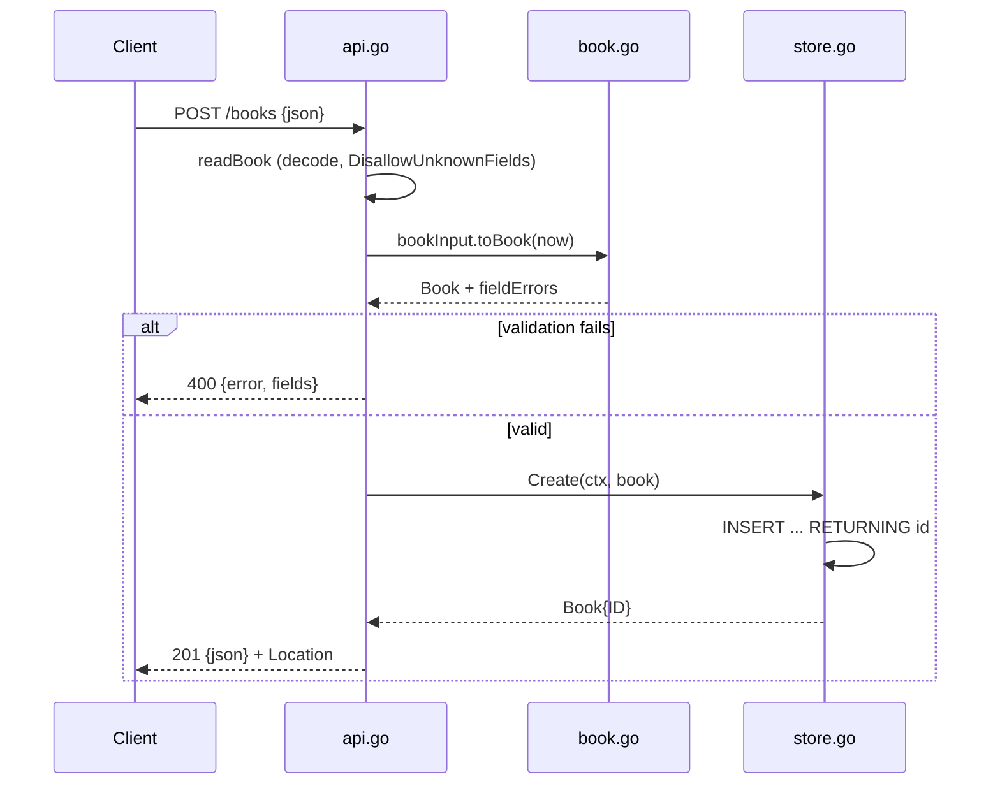

# Flow

A `POST /books` request is size-capped (1 MiB), then decoded strictly — unknown or duplicate fields are rejected. `bookInput.toBook` trims and validates: title and author are required (≤500 runes), `year` must fall in `[1, nextYear]` when present, and a non-blank `isbn` must pass an ISBN-10/13 check-digit test. Valid input is inserted via a single-connection WAL SQLite database and returned with its assigned ID and a `Location` header. Notable: strict decoding with per-field error messages, ISBN check-digit validation, `405`/`Allow` method handling and a JSON catch-all `404` all go beyond the minimal spec; persistence is a real on-disk SQLite file, verified to survive reopen.
