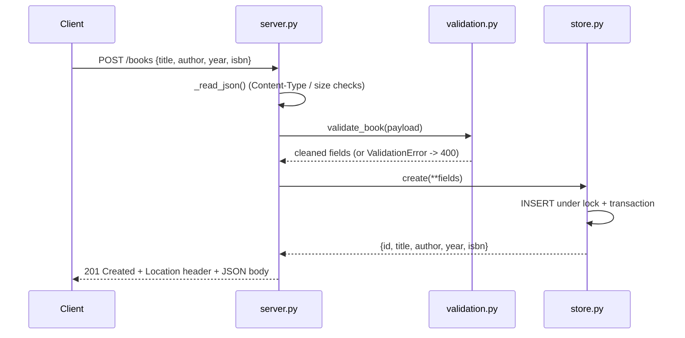

# Flow

A `POST /books` request is dispatched by `_dispatch`/`_route`, which enforces
`Content-Type: application/json` and a 1 MiB body cap in `_read_json`, parses the
JSON, and passes it through `validate_book` (strict types: strings trimmed,
`title`/`author` required, `year` an in-range int, `isbn` format-checked). The
cleaned fields are inserted by `BookStore.create` under a `threading.Lock` with a
connection-level transaction, and the new row (with server-assigned `id`) is
returned as `201 Created` with a `Location` header. Every response is JSON via
`_send`; errors flow through `ValidationError`/`ApiError` to consistent
`{"error": ...}` bodies. The server is a threaded `http.server` using only the
Python standard library — no external framework or ORM.
