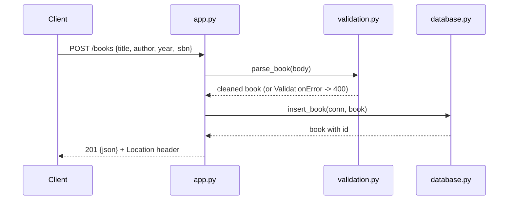

# Flow

A request to `POST /books` reads the JSON body (accepted even without a `Content-Type` header via `force=True`), validates it through `validation.parse_book()` which collects every field error at once and raises `ValidationError` (mapped to a 400 JSON response) if any field is bad. On success the cleaned record is inserted via a per-request SQLite connection managed by Flask's `g`/`teardown_appcontext`, and the new book is returned as 201 JSON with a `Location` header. Input validation, structured error handling (400/404/405/500), and SQLite persistence are all present; the author filter is a case-insensitive, accent-aware substring match.
