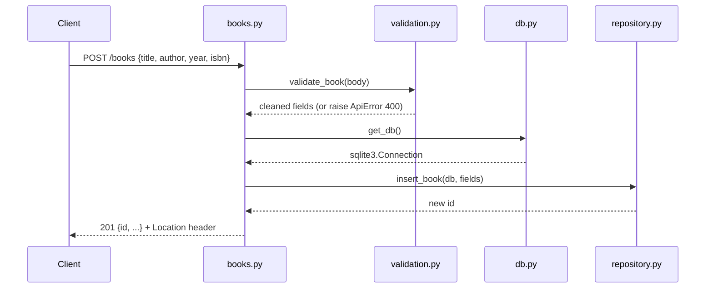

# Flow

A request to `POST /books` parses the JSON body (`_json_body`, rejecting non-objects with 400), validates it via `validation.py:validate_book` (title/author required, year bounds checked, ISBN checksum-validated and normalized), then inserts through the parameterized SQL in `repository.py:insert_book` using a per-request SQLite connection from `db.py:get_db`. The handler returns `201` with the created record and a `Location` header pointing at the new resource. Errors are rendered as JSON throughout via `errors.py` (both custom `ApiError` and Werkzeug `HTTPException`), so clients never receive Flask's HTML error pages.
