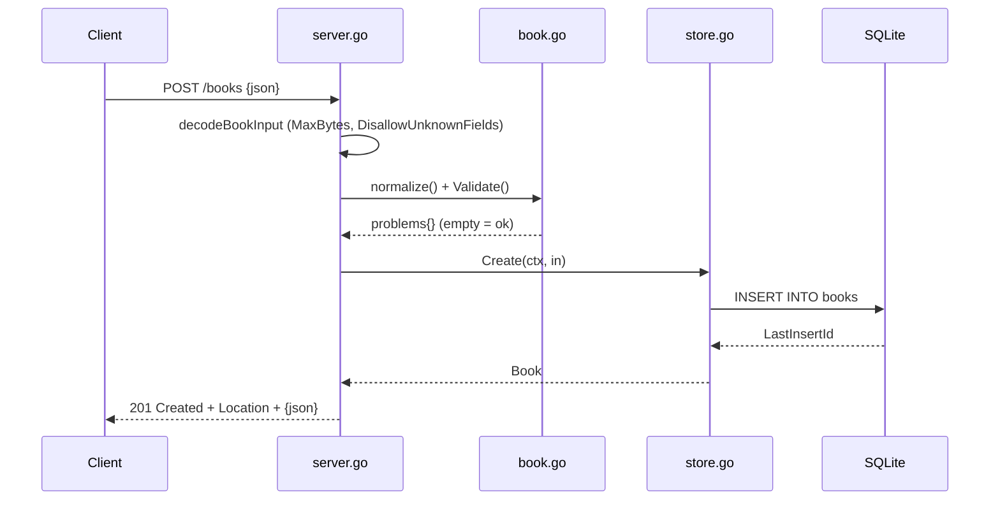

# Flow

A `POST /books` request body is capped at 1 MiB and decoded with unknown fields disallowed and trailing content rejected. Input is trimmed and the ISBN canonicalised, then validated (title and author required, year range, ISBN-10/13 check digit). Valid input is inserted into SQLite; a duplicate non-empty ISBN surfaces as `ErrDuplicateISBN` → 409. The created book is returned as JSON with a `Location` header. Error handling is thorough: validation errors return a per-field map, store errors map to 404/409/500, and responses are consistently JSON.
