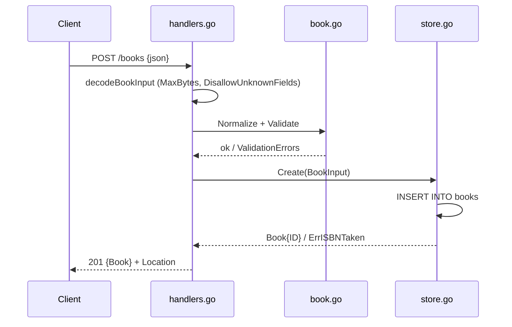

# Flow

A `POST /books` request is size-capped (1 MiB) and decoded with unknown-field rejection and
single-object enforcement. The input is whitespace-trimmed then validated (title/author
required; optional year-range and ISBN shape checks). On success the store inserts the row and
returns the book with its assigned ID; a duplicate ISBN maps to `ErrISBNTaken` → 409. The
handler sets a `Location` header and returns 201 with the JSON body. Validation failures return
422 with field-level `details`; malformed/oversized/trailing JSON returns 400/413. Notable:
graceful shutdown on SIGINT/SIGTERM, `ReadHeaderTimeout` set, single-connection pool to keep
SQLite writes serialized.
