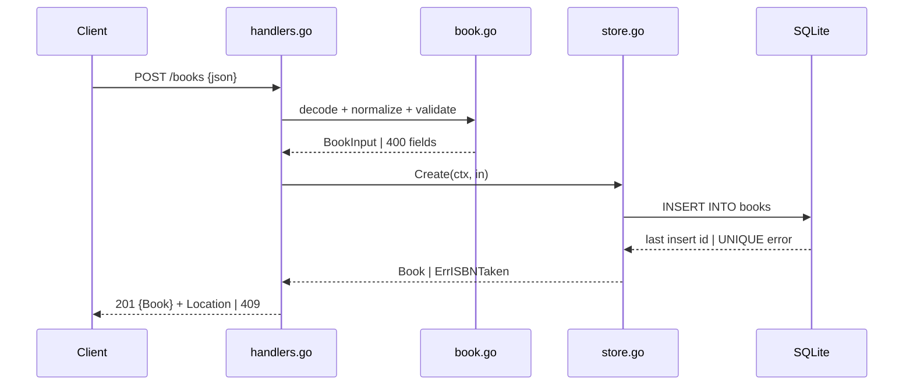

# Flow

A `POST /books` request is capped at 1 MiB, JSON-decoded into a `BookInput`, then normalized (trim title/author, strip ISBN to bare digits) and validated (title and author required; year and ISBN checked when present). On validation failure the handler returns `400` with a per-field map. Otherwise `store.Create` inserts the row via the pure-Go `modernc.org/sqlite` driver; a duplicate ISBN maps to `409`, success returns `201` with the created `Book` and a `Location` header. Reads use `COALESCE(isbn,'')` so a NULL ISBN serializes as `""`, and empty ISBNs are stored as NULL so multiple ISBN-less books coexist. The server runs with a single DB connection and supports graceful shutdown on SIGINT/SIGTERM.
