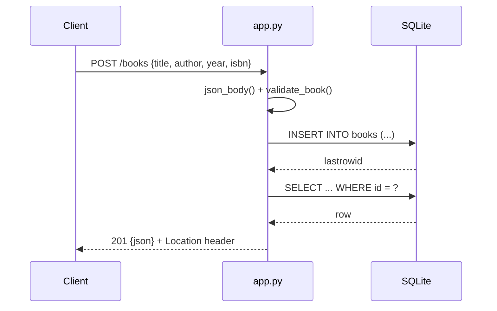

# Flow

A `POST /books` request parses the JSON body (rejecting non-JSON and non-object payloads), runs `validate_book()` which enforces required non-empty `title`/`author`, integer `year` within `[0, next year]`, and string `isbn`. Valid payloads are inserted into the SQLite `books` table; the freshly-inserted row is re-fetched and returned as JSON with a 201 status and a `Location` header. Validation failures raise `ValidationError`, handled centrally into a 400 JSON response with per-field `details`. A per-request connection is opened lazily via Flask's `g` and closed on teardown.
