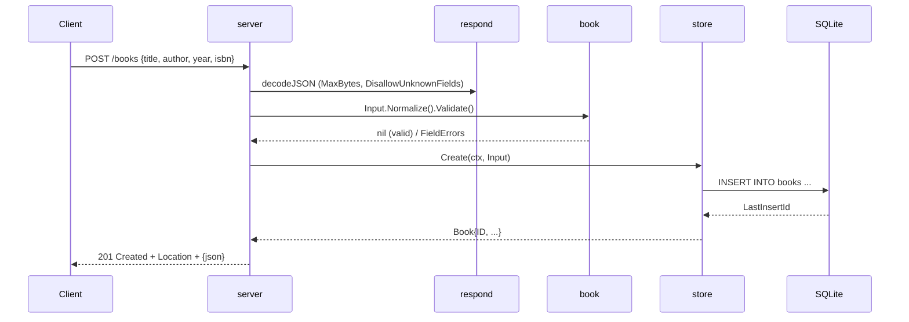

# Flow

The create path is the most representative flow. `server.createBook` strictly decodes the JSON body (capped at 1 MiB, unknown fields rejected), normalizes and validates the input in the HTTP-agnostic `book` package (title and author required; optional year range and ISBN check-digit checks), then calls `store.Create`, which inserts a row into the embedded SQLite database and returns the book with its assigned ID. The handler responds `201 Created` with a `Location` header and the JSON body. Errors are mapped centrally: validation → `400` with per-field details, missing rows → `404` via `store.ErrNotFound`, and anything unexpected is logged and returned as a generic `500`. Requests pass through a logging middleware that records method, path, status, and duration; the server installs graceful shutdown on SIGINT/SIGTERM.
