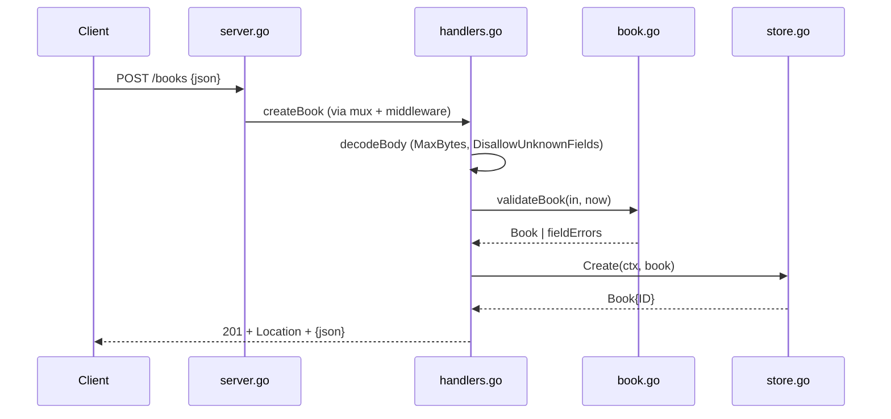

# Flow

A `POST /books` request passes through the `logRequests` and `recoverPanics` middleware, is routed by Go 1.22+ `http.ServeMux` method patterns, then decoded with a 1 MiB body cap and `DisallowUnknownFields`. `validateBook` trims and checks required `title`/`author`, bounds `year`, and verifies the ISBN-10/13 checksum, returning per-field errors (400) on failure. On success the book is inserted via a parameterized SQLite statement and echoed back as 201 with a `Location` header. Input validation, structured error bodies, 405/Allow handling, and graceful shutdown are all present — beyond the task minimum.
