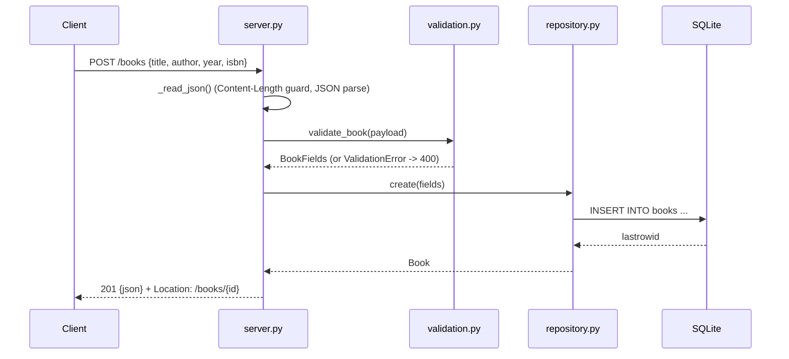

# Flow

A `POST /books` request is read with a `Content-Length` guard (rejecting bodies over 1 MiB with 413 before reading) and parsed as a JSON object. `validate_book()` enforces that `title` and `author` are required non-blank strings, normalises an optional `year` (range-checked) and `isbn` (format-checked, hyphens/spaces stripped), collecting all field errors into a single 400. The validated `BookFields` are inserted via a lock-guarded SQLite connection, and the stored `Book` is returned as 201 with a `Location` header. Errors are centrally mapped in `_dispatch` (`ApiError`→status, `ValidationError`→400, unexpected→500). The server is threaded (`ThreadingHTTPServer`) with a single shared connection serialised by a lock.
