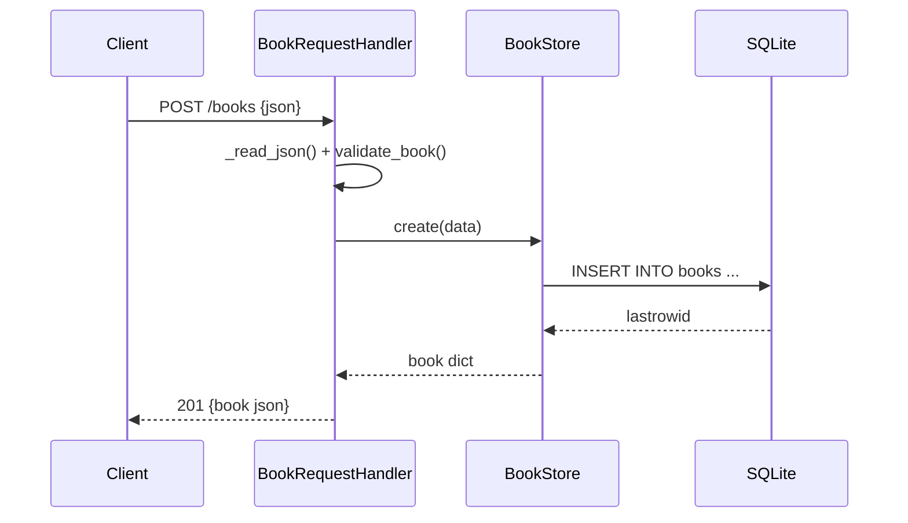

# Flow

A `POST /books` request is dispatched by `_dispatch("POST")`, which reads and JSON-decodes the body (enforcing a 1 MB cap), validates it through `validate_book()` (title and author required, year/isbn optional and type-checked), then calls `BookStore.create()`. The store inserts the row under a shared lock against a single `check_same_thread=False` SQLite connection and re-reads it to return the full record, which is serialized as JSON with status 201. Validation failures raise `ValidationError`, caught in `_dispatch` and returned as `400 {"error": ...}`. Storage is real SQLite (file or `:memory:`), not in-process state.
