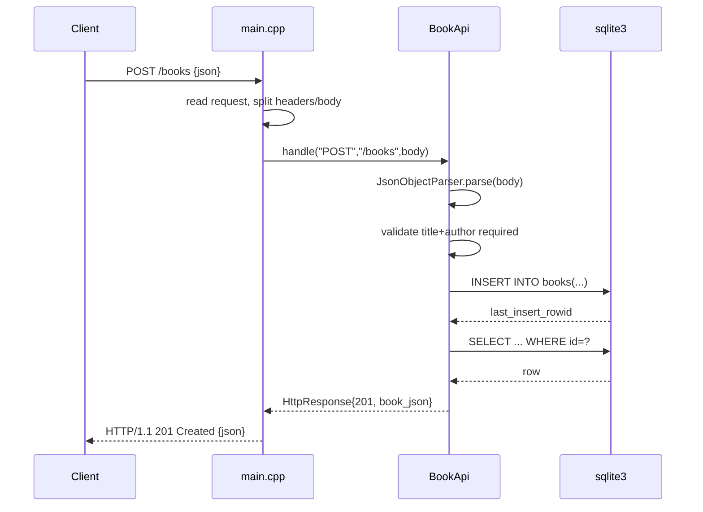

# Flow

A request to `POST /books` is read off the socket in `main.cpp`, which parses the request line and extracts the body using `Content-Length`, then calls `BookApi::handle`. The handler parses the JSON body with a hand-written flat-object parser, enforces that `title` and `author` are non-empty strings (400 otherwise), validates optional `year`/`isbn` types, inserts via a prepared statement, re-selects the created row, and returns it as `201`. Routing is a linear chain of `if` checks keyed on method and path prefix. There is no external HTTP or JSON library — both the TCP server and JSON are hand-rolled. The server is single-threaded and handles one connection at a time (`Connection: close`).
