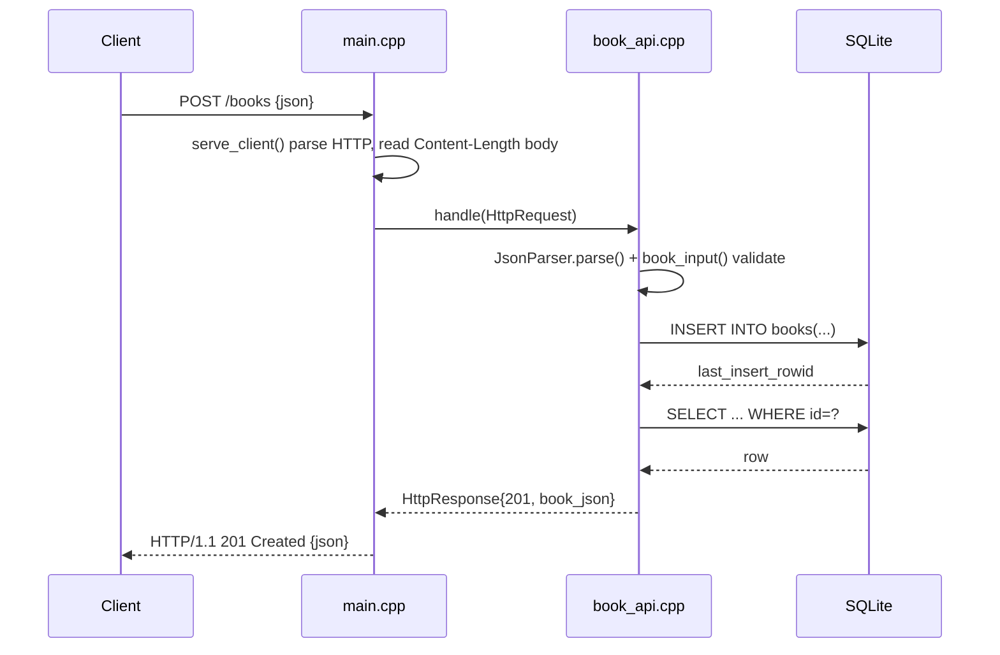

# Flow

A `POST /books` request is read off a blocking POSIX socket in `serve_client()`, which parses the request line and `Content-Length` before handing a method/path/body triple to `BookApi::handle()`. The handler parses the body with a hand-written recursive-descent JSON parser, rejects missing/blank `title` or `author` (400) and out-of-range `year`, then inserts via a prepared statement and re-selects the row to echo the persisted record as JSON (201). Notable: the JSON parser is bespoke (no third-party library), strings are bound with `SQLITE_TRANSIENT` so there is no injection surface, the `?author=` filter is exact-match only (SQL `=`, not `LIKE`), and the server is single-threaded/blocking (one client at a time, `Connection: close`). `handle()` is fully decoupled from the socket layer, which is what makes the in-process test possible.
