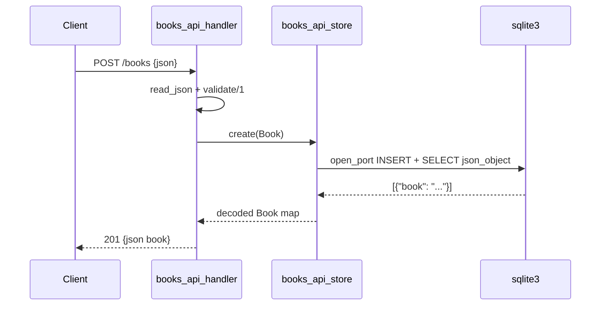

# Flow

A `POST /books` is read by Cowboy's `init/2`, which reads the body (`read_json`), decodes it with
`jsx`, and runs `validate/1` (title and author must be non-empty binaries). On success it calls
`books_api_store:create/1`, which builds an `INSERT ... ; SELECT json_object(...)` statement and runs
it by spawning the external `sqlite3 -json` binary as a port, then decodes the returned JSON row and
replies `201`. Note deviations: SQL is assembled by string interpolation with manual single-quote
escaping rather than parameterized queries; a fresh `sqlite3` OS process is spawned per request (no
connection pooling); the DB file path is fixed via application env.
