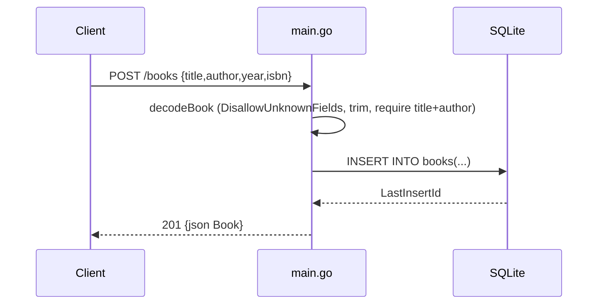

# Flow

A `POST /books` request is routed by `ServeHTTP` on the exact path `/books`,
then `decodeBook` decodes a single JSON object (rejecting unknown fields and
trailing content), trims and validates that `title` and `author` are non-empty,
and on success inserts the row into SQLite and returns the created book with its
generated id as `201 Created`. Validation failures return `400`; other paths use
a single `net/http` handler with `strings`-based path dispatch (no router
library). Error handling is present throughout; DB access is synchronous with
`SetMaxOpenConns(1)`.
