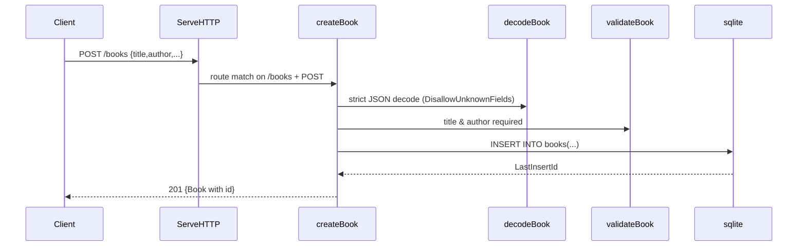

# Flow

A request to `POST /books` is dispatched by `API.ServeHTTP` on an exact path match. `decodeBook` performs a strict decode that rejects unknown fields and trailing JSON, then `validateBook` enforces non-empty `title` and `author` (400 on failure). On success the row is inserted into SQLite and the created book, with its generated `id`, is returned as JSON with status 201. Routing is hand-rolled via path prefix matching rather than a router library; DB access is synchronous with `SetMaxOpenConns(1)` to serialize the single SQLite connection.
