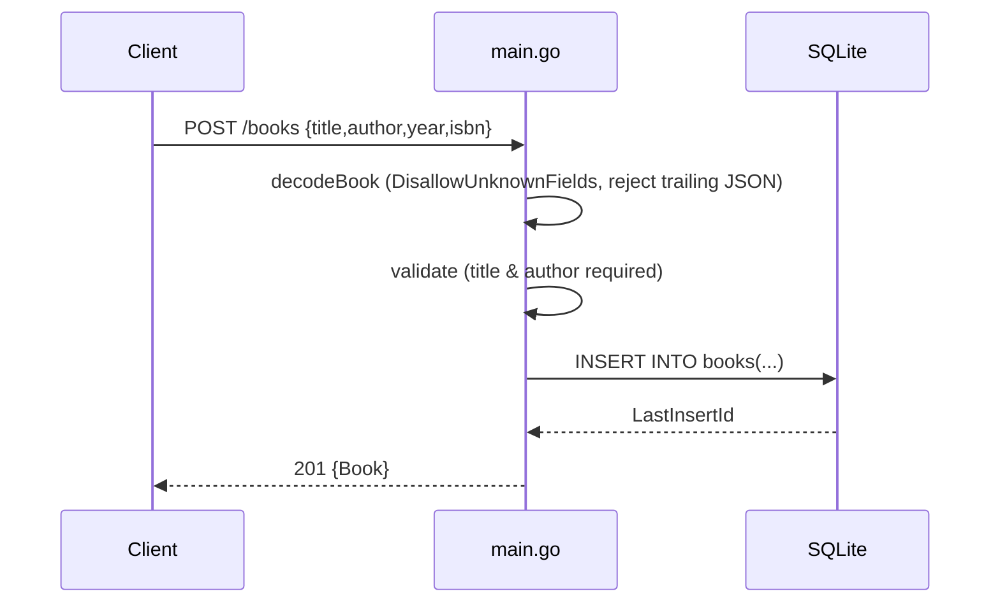

# Flow

A request to `POST /books` is routed by `API.ServeHTTP` (a hand-rolled path
switch, no framework). The body is decoded with `DisallowUnknownFields` and a
1 MiB cap, rejecting unknown or trailing JSON with 400. `validate` enforces
non-empty title and author (trimmed). The row is inserted via a parameterized
query and the new id is read back from `LastInsertId`. Errors return JSON error
objects with matching status codes. Routing distinguishes `/books` (collection)
from `/books/{id}` (item) by path prefix and rejects nested/empty ids. DB access
is synchronous with `SetMaxOpenConns(1)`.
