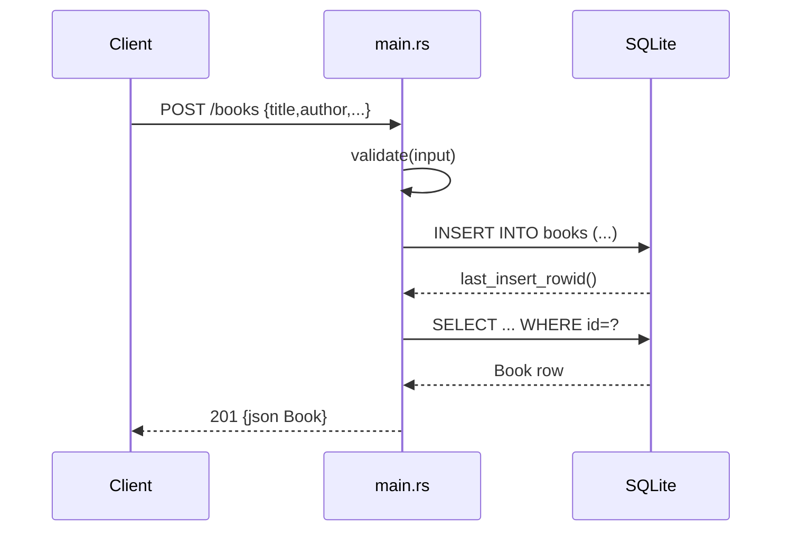

# Flow

A `POST /books` request is deserialized into `BookInput`, validated (`title`/`author` must be non-empty after trim, else `400`), then inserted into the SQLite `books` table behind an `Arc<Mutex<Connection>>`. The handler reads the row back by `last_insert_rowid()` and returns the full `Book` as JSON with `201 Created`. All handlers share one serialized connection via the mutex (synchronous `rusqlite` calls inside async handlers). Not-found cases return a `404` JSON error; DB errors map to `500`.
