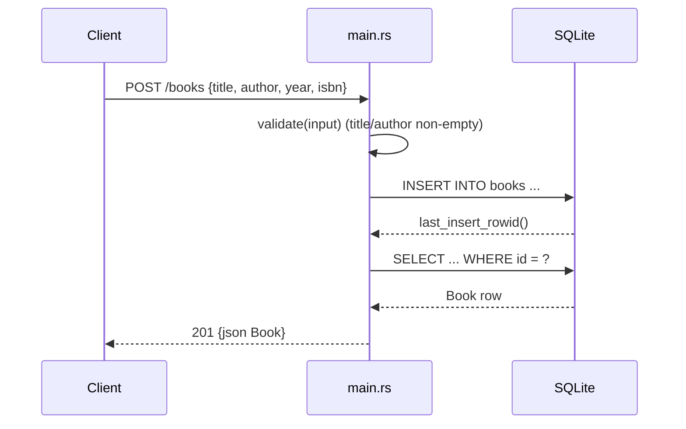

# Flow

A `POST /books` request is deserialized into `BookInput`, validated (empty/whitespace
`title` or `author` → 400), inserted into the SQLite `books` table, then re-selected by
`last_insert_rowid()` and returned as a JSON `Book` with 201 Created. All handlers share
a `SqlitePool` via `State<AppState>`; errors flow through the `ApiError` enum, which
implements `IntoResponse` to emit `{"error": msg}` with the matching status code. No
pagination; the `?author=` filter is an exact-match SQL equality.
