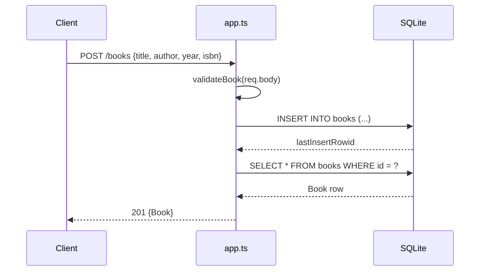

# Flow

A request to `POST /books` is parsed by `express.json()`, validated by `validateBook()` (rejecting with `400` when `title` or `author` is missing/blank, or when `year`/`isbn` have the wrong type), then inserted into the `node:sqlite` `books` table via a prepared statement. The handler re-selects the inserted row and returns it as JSON with status `201`. Read, update, and delete follow the same prepared-statement pattern, returning `404` when the row is absent. A trailing error-handling middleware maps JSON `SyntaxError` to `400` and other errors to `500`.
