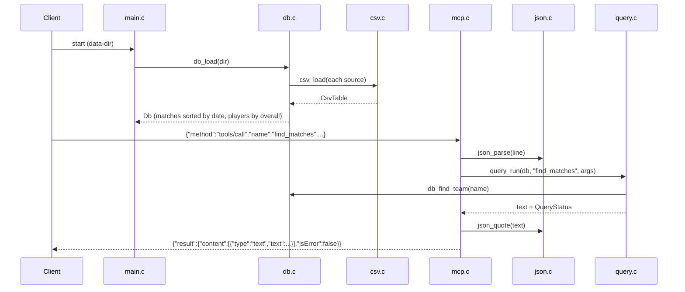

# Flow

On startup `main.c` loads the six CSVs via `db.c:db_load`, which de-duplicates overlapping (competition, season) pairs, normalizes team names, marks knockout finals, and sorts matches by date and players by overall rating. The server then reads newline-delimited JSON-RPC requests from stdin in `mcp.c:mcp_serve`; each request is parsed by `json.c`, dispatched by method, and `tools/call` routes through `query.c:query_run` to one of seven tool functions, which filter the in-memory arrays and format a human-readable text block. The result text is JSON-escaped and written back as one line per request. Notifications (requests without an `id`) are intentionally not answered. Errors are reported both as JSON-RPC errors (unknown method/tool, malformed input) and, for tool-level problems like an unresolvable team, as a successful result with `isError:true`.
