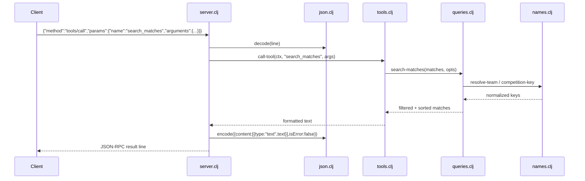

# Flow

On startup `-main` loads every CSV under the data dir (default `data/kaggle`, overridable by arg or `$BRAZIL_SOCCER_DATA`) once into an in-memory `{:matches :players}` context, logging progress to **stderr** so stdout carries protocol only. Each input line is decoded, dispatched by method, and answered. A `tools/call` resolves the named tool in `tool-specs`, runs its handler against the loaded context, and returns the formatted text wrapped in MCP `content`. Tool-level errors (e.g. unknown team) are returned as `isError:true` content rather than thrown; unknown tools/methods and malformed JSON become JSON-RPC error objects. Queries are pure functions over the loaded vectors; team/competition names are normalized via `names.clj` so `Palmeiras-SP`, `palmeiras`, and full club names resolve to one key. Notable: no external dependencies (custom CSV + JSON), data loaded eagerly at startup, and the BR-Football dataset is deliberately excluded for competition-seasons already covered by a primary file to avoid double-counting.
