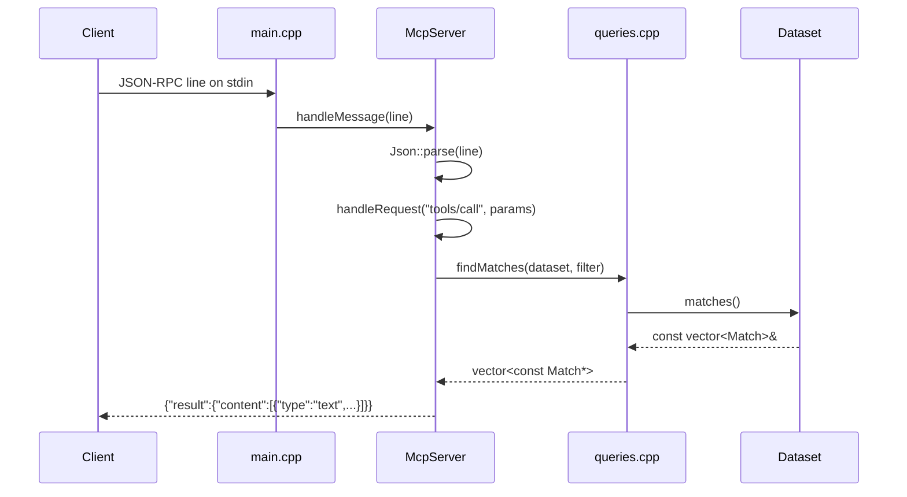

# Flow

On startup `main()` calls `Dataset::load()` once, parsing all six CSVs into in-memory `Match`/`Player` vectors (fixtures deduped across the overlapping Brasileirão/Copa sources via a season+teams+score key). The server then reads one JSON-RPC message per line from stdin. A `tools/call` for `find_matches` builds a `MatchFilter` from the arguments (normalizing team names and dates), filters the in-memory matches, sorts most-recent-first, formats a text block, and writes the response to stdout. Logs go to stderr so they never corrupt the stdout JSON stream. Notifications (requests without `id`) get no response; parse/method/argument errors map to JSON-RPC error codes.
