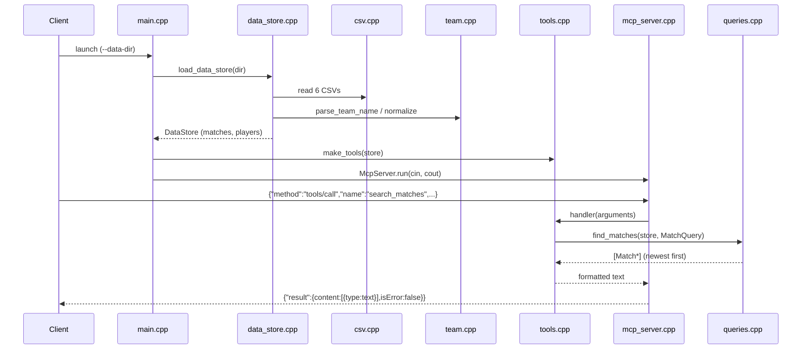

# Flow

On startup `main` loads all six Kaggle CSVs into an in-memory `DataStore` (matches sorted oldest-first, plus FIFA players), normalizing team names and dropping duplicate/overlapping/unparseable rows, then logs the counts to stderr so stdout stays a clean protocol stream. `McpServer::run` reads one JSON-RPC message per line; a `tools/call` for `search_matches` builds a `MatchQuery` from the arguments (requiring at least one filter), calls `find_matches` to get matching `Match` pointers, formats them into human-readable lines via `format_matches`, and wraps the text in an MCP `content` result. Tool-handler exceptions are caught and returned as `isError:true` text rather than JSON-RPC errors; malformed input validation lives in the `*_arg` helpers (type checks, limit 1-200, date parsing, venue whitelist). Processing is synchronous and single-threaded, in-memory, with no network, pagination (results are capped by `limit` with an "N more in dataset" note), or persistence.
