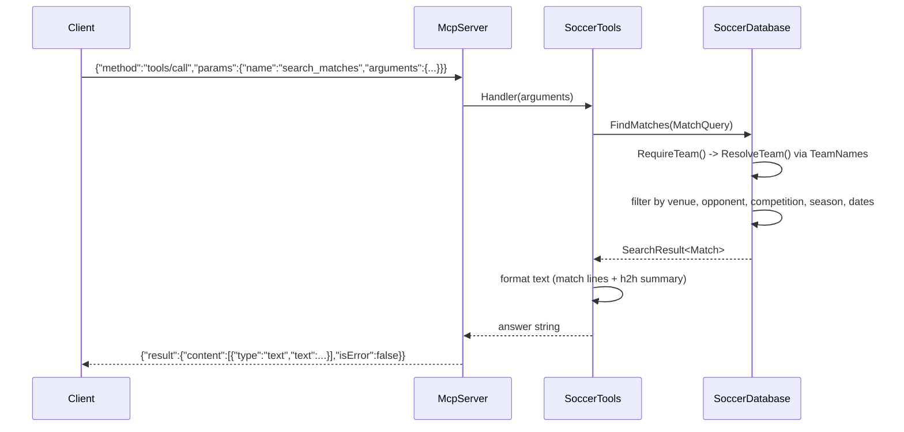

# Flow

At startup `Program.cs` calls `DatasetLoader.Load()` to read the six CSVs into `Match`/`Player` records (unparseable rows skipped), then builds a `SoccerDatabase` that de-duplicates matches by a date/teams/score fingerprint and indexes them by canonical team key. The server then reads JSON-RPC lines from stdin.

A `tools/call` for `search_matches` is the representative request: `McpServer.HandleMessage` parses the line, dispatches to the `SoccerTools` handler, which builds a `MatchQuery` and calls `SoccerDatabase.FindMatches`. Team names are resolved through `TeamNames.Parse` + `ResolveTeam` (alias table, state-suffix stripping, whole-word containment fallback) so "Palmeiras-SP" and "Palmeiras" match the same key. Results are filtered, ordered newest-first, truncated to the limit, formatted as text, and returned as an MCP text content result.

Notable characteristics:
- Fully in-memory and synchronous; the whole dataset is loaded once at startup and queried with LINQ. No pagination beyond a `limit` cap, no caching layer, no external API calls (optional APIs in the spec are not used).
- Input validation is present: required-argument checks and venue/date parsing raise `ArgumentException`, which the server converts into an `isError` text result rather than a protocol crash.
- Unknown teams raise an error surfaced to the caller; unknown JSON-RPC methods return error code -32601; malformed JSON returns -32700.
- Team-name resolution is heuristic (alias table of ~11 clubs plus containment matching); ambiguous bases like "atletico"/"america" keep their state in the key.
