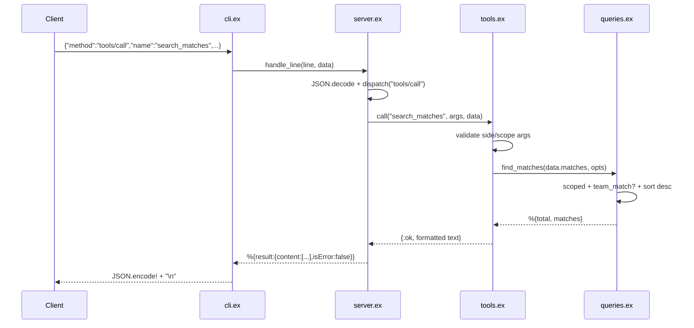

# Flow

At startup `cli.ex:main/1` calls `Data.load/1`, which reads the six CSVs via `CSV.parse_with_headers/1`, builds `Match`/`Player` structs (normalizing team names and dates), drops incomplete rows, and de-duplicates overlapping match files — the data is loaded once and threaded through every request as an immutable struct. Each stdin line is decoded, dispatched by `server.ex`, delegated to a pure handler in `tools.ex` that validates arguments and calls the matching pure function in `queries.ex`, and the result is formatted as human-readable text and returned as an MCP `content` block. Logs go to stderr so they never corrupt the stdout protocol stream. Notable: everything below the CLI is pure (no processes, no state); tool-level errors are surfaced as `isError:true` results rather than protocol errors.
